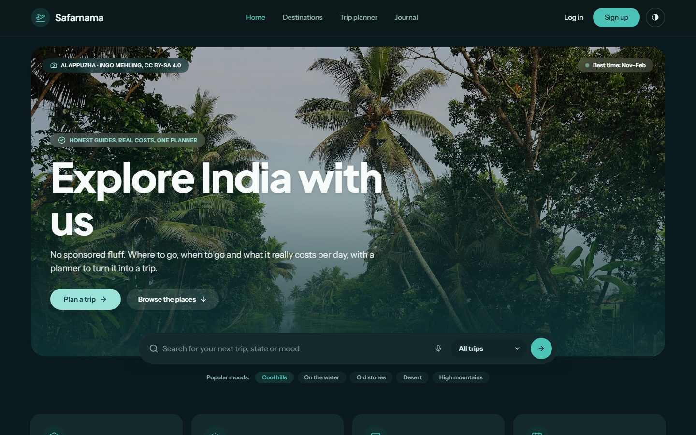
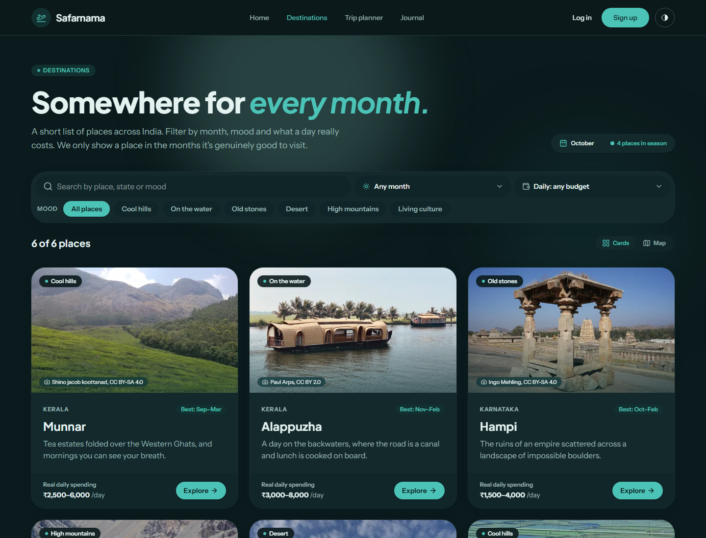

# Safarnama

**Honest travel guides to India, and a planner to match.**

Where to go, when to go and what a day really costs in rupees, plus a trip planner that turns a guide into days, a budget, a packing list and bookings. It's a rebuild of my 2023 HTML/Bootstrap tourism site.

**Live site:** [safarnama-cyan.vercel.app](https://safarnama-cyan.vercel.app)



## Features

- **Destination guides.** Each place has when to go (a 12-month grid), a daily budget per person, how long to stay, how to get there, a photo gallery with a lightbox and a map of the nearest places.
- **Find a place.** Search by name, state or mood, then filter by month, mood and daily budget. Switch between cards and a map. Filters live in the URL, so a filtered list can be shared.
- **Trip planner.** Drag-and-drop day-by-day itinerary, route map, budget tracker, weather for your dates, packing checklist and bookings. Export to your calendar (`.ics`) or print it as a PDF.
- **Works without an account.** Guests plan in the browser. Sign in and the trips sync to your account, including the ones you made as a guest.
- **Accounts.** Email and password, magic links and optional Google sign-in through Supabase Auth.
- **Design.** Light and dark mode, phone to ultrawide layouts (the page scales up on screens wider than ~1800px), scroll reveals, parallax and cross-page view transitions. Motion is turned off for people who prefer reduced motion.

## Screenshots



## Tech stack

| | |
| --- | --- |
| Framework | [Astro 7](https://astro.build), server-rendered, with React 19 islands for the interactive parts |
| Styling | Tailwind CSS v4 with light and dark design tokens in `src/styles/global.css` |
| Auth and data | [Supabase](https://supabase.com) Auth and Postgres, called through Astro Actions validated with Zod |
| Planner state | Zustand with Immer, saved to `localStorage` and synced to Supabase |
| Maps | MapLibre GL with free [OpenFreeMap](https://openfreemap.org) tiles (no API key) |
| Weather | [Open-Meteo](https://open-meteo.com) (no API key) |
| Hosting | [Vercel](https://vercel.com), deployed on every push to `main` |
| Design | Laid out in [Google Stitch](https://stitch.withgoogle.com); the reference screens are in `design/stitch/` |

## Getting started

You need Node.js 22 or newer.

```sh
npm install
cp .env.example .env   # then add your Supabase keys (see below)
npm run dev            # http://localhost:4321
```

The site runs without Supabase keys. Guides and the planner work; only sign-in and cloud saving are switched off.

### Environment variables

| Variable | What it's for |
| --- | --- |
| `PUBLIC_SUPABASE_URL` | Your Supabase project URL |
| `PUBLIC_SUPABASE_PUBLISHABLE_KEY` | The publishable (public) key from **Project Settings → API Keys** |
| `PUBLIC_GOOGLE_AUTH_ENABLED` | `true` to show "Continue with Google" once that provider is on in Supabase |

### Supabase setup

1. Create a free project at [supabase.com](https://supabase.com) and copy the URL and publishable key into `.env`.
2. Under **Authentication → URL Configuration**, set the Site URL to `http://localhost:4321` and add `http://localhost:4321/auth/callback` to the redirect URLs. Add your production URLs the same way.
3. Run [`supabase/migrations/0001_trips.sql`](supabase/migrations/0001_trips.sql) once in the SQL Editor. It creates the `trips` table with row-level security, so each person only sees their own trips. Until you do, the planner keeps working and saves on the device.
4. Optional: turn on **Authentication → Sign In / Providers → Google** and set `PUBLIC_GOOGLE_AUTH_ENABLED=true`.

## Commands

| Command | Action |
| --- | --- |
| `npm run dev` | Start the dev server at `localhost:4321` |
| `npm run build` | Build for production into `./dist/` |
| `npm run preview` | Preview the production build |
| `npx astro check` | Type-check `.astro`, `.ts` and `.tsx` files |

## Project structure

```text
src/
├── actions/              Astro Actions for auth and saving trips
├── assets/destinations/  Destination photos (optimised at build time)
├── components/
│   ├── auth/             Login, sign-up and password forms
│   ├── destinations/     Filters, cards, gallery and map
│   ├── home/             Hero search bar
│   └── planner/          Trip planner: itinerary, budget, packing, bookings, sidebar
├── content/destinations/ One Markdown guide per place
├── layouts/              Page and auth layouts
├── lib/                  Shared helpers, Supabase client and planner store
├── pages/                Routes (see below)
└── styles/global.css     Design tokens, utilities and motion
design/stitch/            Google Stitch reference screens
supabase/migrations/      Database schema
```

### Routes

| Route | Page |
| --- | --- |
| `/` | Home |
| `/destinations` | All destinations, with filters and a map view |
| `/destinations/[id]` | A destination guide |
| `/planner` | Trip planner (`?trip=` opens a trip, `?add=` adds a place) |
| `/login`, `/signup` | Log in or create an account |
| `/forgot-password`, `/reset-password` | Reset a password |
| `/account` | Account details and log out (signed in only) |
| `/auth/callback` | Where email links and Google sign-in return to |
| `/auth/logout` | `POST` only; signs out and returns home |

## Adding a destination

Add a Markdown file to `src/content/destinations/`. The frontmatter is checked against the schema in `src/content.config.ts`:

```yaml
name: Munnar
state: Kerala
tagline: Tea estates folded over the Western Ghats.
vibes: [hills]                          # hills, water, heritage, desert, mountains, culture
bestMonths: [9, 10, 11, 12, 1, 2, 3]    # 1 = January
budgetPerDay: { low: 2500, high: 6000 } # per person, in rupees
daysNeeded: { min: 2, max: 4 }
coordinates: { lat: 10.0889, lng: 77.0595 }
gettingThere: Kochi airport is about 110 km away…
hero: ../../assets/destinations/munnar.jpg
heroAlt: Rows of tea bushes covering rolling green hills
credit: { author: …, license: CC BY-SA 4.0, source: https://commons.wikimedia.org/… }
gallery: []                             # optional extra photos, each with its own credit
```

Write the guide in the body. A `## What to do` list renders as cards, and the first paragraph under `## Good to know` also appears as a tip on the home page.

## Deployment

The project is connected to Vercel through GitHub, so every push to `main` deploys to production. Set the three `PUBLIC_` environment variables in the Vercel project, and add the production URL and its `/auth/callback` to the Supabase redirect URLs.

## Roadmap

- A travel journal (the menu already links to `/journal`)
- Read-only share links for trips
- More destinations

## Credits

Photos come from [Wikimedia Commons](https://commons.wikimedia.org) under Creative Commons licences. Each photo's author, licence and source are stored next to it and credited wherever it appears.

Built by [Adithya Kammara](https://github.com/AdithyaKammara).
